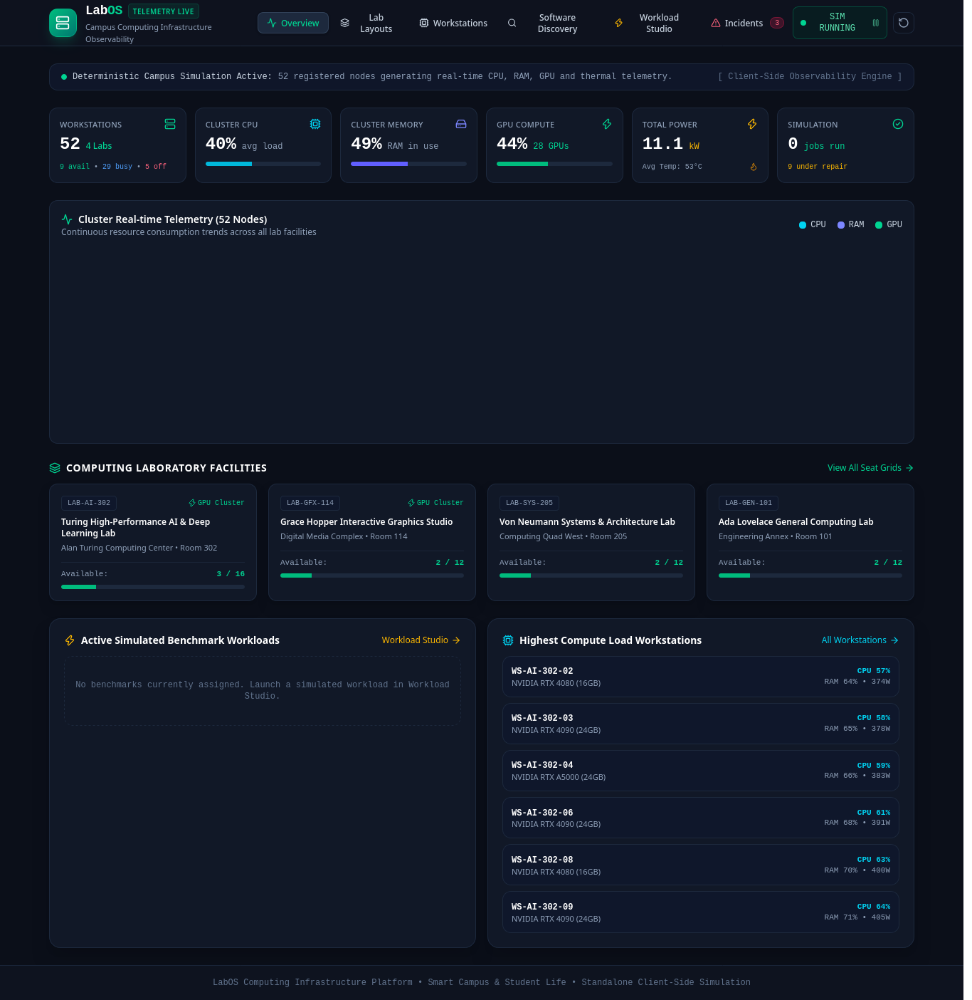

# LabOS — University Computing Infrastructure Observability Platform

[](https://react.dev)
[](https://www.typescriptlang.org/)
[](https://vitejs.dev/)
[](https://tailwindcss.com/)
[](https://vitest.dev/)

**LabOS** is a university computing infrastructure management and observability platform. Designed to resemble an SRE systems monitoring product rather than a conventional university dashboard, LabOS delivers real-time simulated cluster telemetry, interactive spatial laboratory layouts, hardware discovery, fault lifecycle tracking, and a workload benchmarking studio.

---

## Dashboard Preview



---

## 1. Problem Statement

University computing laboratories house massive computing capacity—high-core CPUs, professional GPUs, substantial DDR5 RAM pools, and specialized software stacks. However, students and researchers frequently encounter severe visibility gaps:

- **Hardware Opacity:** Uncertainty over which specific laboratory or pod contains dedicated GPUs (e.g., RTX 4090s, A5000s) versus integrated graphics.
- **Software Discovery:** Inability to find workstations with pre-configured toolchains (e.g., CUDA 12.4, PyTorch, Blender, MATLAB, LLVM).
- **Resource Fragmentation:** Lack of visibility into real-time utilization, leading to students queuing for occupied machines while idle clusters remain undiscovered.
- **Maintenance Blindspots:** Machines suffering from driver crashes, thermal throttling, or hardware faults remain unmarked.

---

## 2. Implemented Features

### A. Infrastructure Overview & Cluster Telemetry
- **52 Registered Workstations** distributed across 4 campus laboratories.
- Real-time aggregation of **Cluster CPU Load**, **Cluster RAM Saturation**, **GPU Compute Utilization**, **Total Power Draw (kW)**, and **Average Thermal Dissipation (°C)**.
- High-frequency area chart powered by **Recharts** tracking rolling cluster performance.

### B. Interactive Spatial Laboratory Layouts
- Visual physical seating grids for:
  1. **Turing High-Performance AI Lab** (Room 302, 16 nodes, NVIDIA RTX 4090 & A5000)
  2. **Grace Hopper Interactive Graphics Studio** (Room 114, 12 nodes, RTX 4080 & 3080 Ti)
  3. **Von Neumann Systems & Architecture Lab** (Room 205, 12 nodes, AMD Ryzen 9 7900X, Arch Linux)
  4. **Ada Lovelace General Computing Lab** (Room 101, 12 nodes, Intel Core i7, Fedora)
- Live per-node gauges showing CPU%, GPU%, and temperature directly on each physical workstation pod.

### C. Hardware Inventory & Multi-Vector Filtering
- Filter workstations by **GPU acceleration**, **operational status** (Available, Busy, Maintenance, Offline), and **target laboratory**.
- Search query parser supporting hostnames, processor models, GPU models, OS distributions, and individual software package tags.

### D. Software Discovery Catalog
- Dynamic indexing of 30+ development frameworks and scientific software packages.
- Instant 1-click lookup of all compatible machines equipped with specific packages (e.g., `CUDA 12.4`, `PyTorch 2.3`, `Blender 4.1`, `MATLAB R2024a`, `Rust 1.78`).

### E. Workload Telemetry Simulator
- Deterministic simulation engine generating continuous telemetry ticks.
- Four realistic benchmark workloads:
  - **LLM LoRA Fine-Tuning (PyTorch):** Saturated CUDA tensor cores (96% GPU, 88% RAM, +24°C delta).
  - **Blender 4.1 Cycles Raytracing:** OptiX-accelerated path-tracing (98% GPU, 85% CPU, +28°C delta).
  - **Clang/LLVM 18 Parallel Compilation:** 32-thread ninja compilation pass (97% CPU, 84% RAM).
  - **OpenFOAM Aerodynamics Simulation:** CFD Navier-Stokes grid mesh computation.
- **Side-by-Side Comparison:** Compare the active benchmark node against an unloaded baseline reference node in real-time.

### F. Hardware Incidents & Fault Lifecycle
- Real-time fault reporting modal with severity levels (`Low`, `Medium`, `High`, `Critical`).
- Interactive status transitions: `Investigating` → `Identified` → `Resolved`.
- Resolving an incident automatically re-commissions the workstation back into the pool as `Available`.

### G. Local Persistence & Demo Reset
- All workload states, incident tickets, and machine status overrides are persisted in `localStorage`.
- **Reset Demo Data:** 1-click restoration of clean seeded demonstration data with full confirmation guards.

---

## 3. Architecture & File Structure

```text
labos/
├── public/
├── src/
│   ├── components/
│   │   ├── dashboard/
│   │   │   ├── ClusterTelemetryChart.tsx  # Recharts time-series stream
│   │   │   ├── OverviewView.tsx           # Primary infrastructure HUD
│   │   │   └── StatCards.tsx              # Real-time aggregate telemetry KPIs
│   │   ├── incidents/
│   │   │   └── IncidentManager.tsx        # Fault ticket lifecycle & resolution
│   │   ├── inventory/
│   │   │   └── WorkstationTable.tsx       # Searchable node registry
│   │   ├── laboratories/
│   │   │   └── LabGrid.tsx                # Spatial physical floor plan & pod cards
│   │   ├── layout/
│   │   │   └── Navbar.tsx                 # Navigation HUD & simulation pause/play
│   │   ├── machines/
│   │   │   └── MachineModal.tsx           # Workstation telemetry inspector
│   │   ├── simulator/
│   │   │   └── WorkloadStudio.tsx         # Side-by-side benchmark simulator
│   │   └── software/
│   │       └── SoftwareDiscovery.tsx      # Inverted software catalog index
│   ├── data/
│   │   └── seedData.ts                    # 52 realistic workstations & 4 labs
│   ├── engine/
│   │   ├── simulator.ts                   # Deterministic telemetry tick engine
│   │   └── simulator.test.ts              # Unit tests
│   ├── store/
│   │   └── useLabStore.ts                 # Zustand store + localStorage
│   ├── types/
│   │   └── index.ts                       # Strict TypeScript interfaces
│   ├── App.tsx
│   ├── main.tsx
│   └── index.css
├── docs/
│   └── screenshots/
│       └── dashboard.png
├── package.json
├── vite.config.ts
├── tsconfig.json
└── README.md
```

---

## 4. Setup & Running Locally

### Prerequisites
- Node.js 18+ (tested with v22)
- pnpm (or npm / yarn)

```bash
# Clone and enter directory
cd labos

# Install dependencies
pnpm install

# Run development server
pnpm dev

# Run Vitest test suite
pnpm test

# Build for production
pnpm build
```

---

## 5. Verification & Testing

Unit tests in `src/engine/simulator.test.ts` verify:
1. Workstation seed constraints (52 nodes across 4 laboratories).
2. Telemetry generation respects offline workstation states (0% utilization).
3. Benchmark workloads accurately ramp GPU and thermal dissipation.
4. Metric snapshot buffer rolling integrity.

Run tests via:
```bash
pnpm test
```
